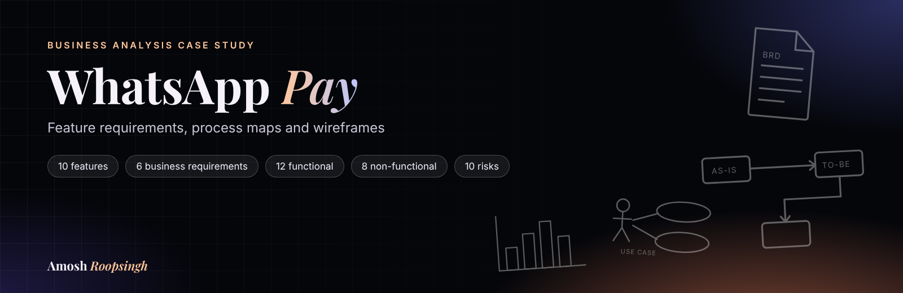
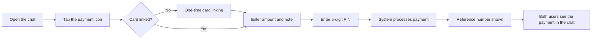
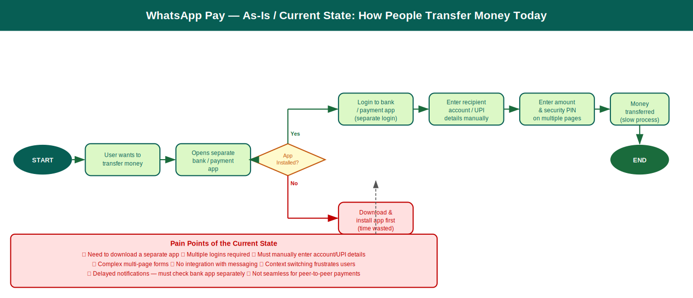
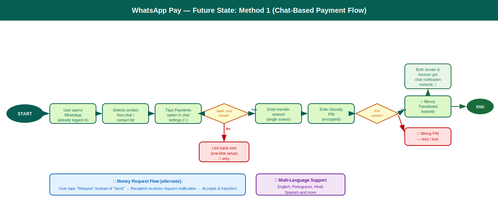
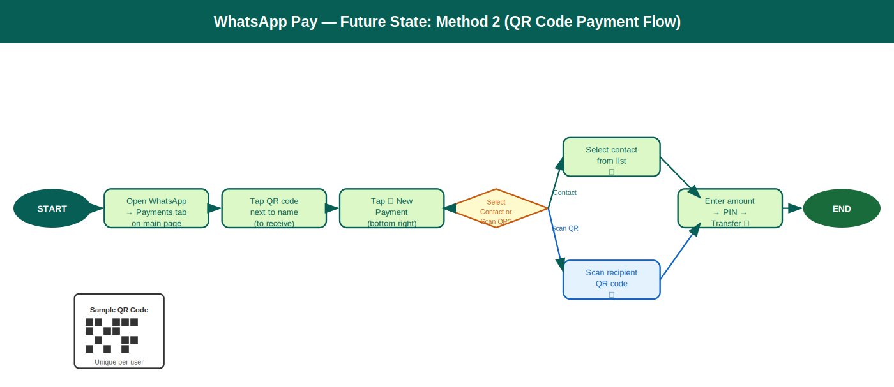
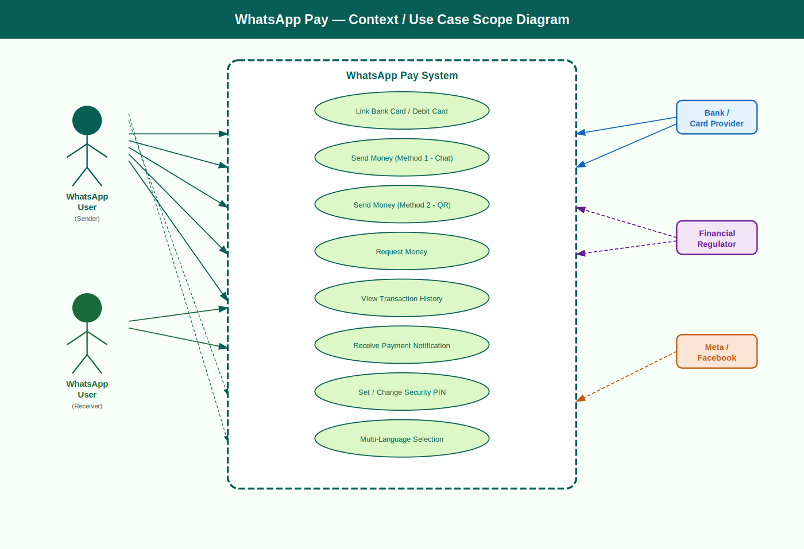
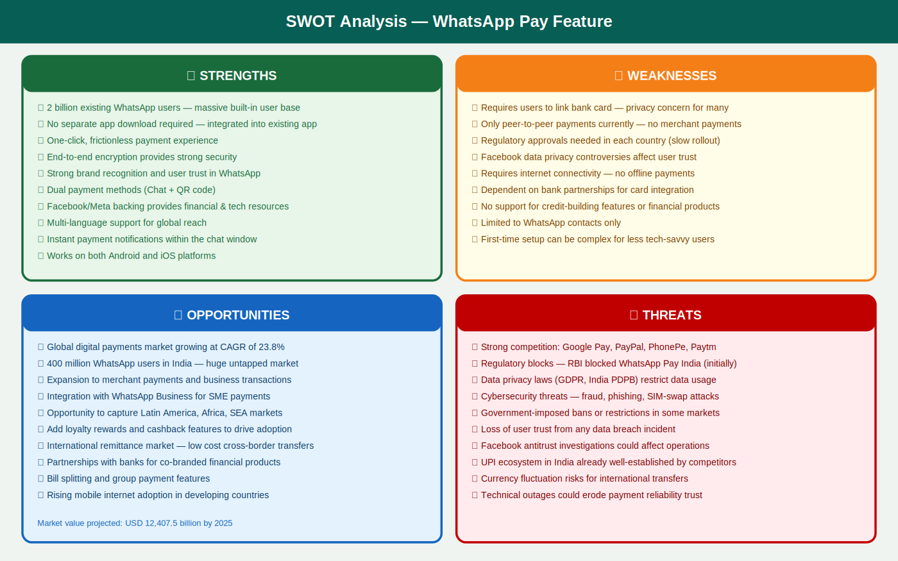
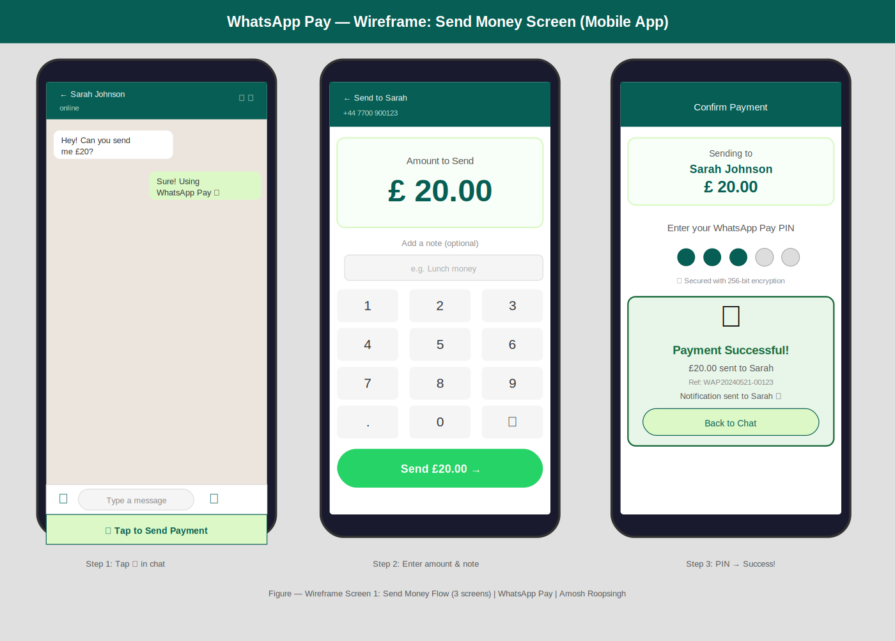
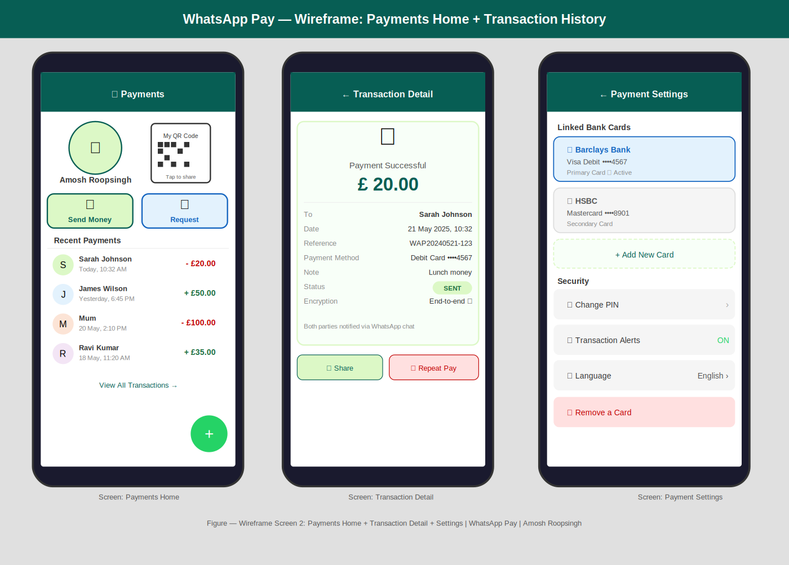

  

  
  
  
  

> **Course project** (Simplilearn CBAP programme, Course-end Project 3). This is a case study. It is not a real client project and is not connected to Meta or WhatsApp.

## The question
How can people send money **inside a chat**, without switching to a separate banking app?

## At a glance

| | |
|---|---|
| **Stakeholders** | 17 (9 internal, 8 external) |
| **Features** | 10 |
| **Requirements** | 6 business, 12 functional, 8 non-functional |
| **Risks** | 10, each with likelihood, impact and a mitigation |
| **Diagrams** | As-Is flow, 2 future-state flows, context and use case diagram, SWOT, 2 wireframe sets |
| **Roll-out plan** | Brazil pilot, then India, then global |

## Business objectives

| Ref | Objective | Success measure | Timeline |
|---|---|---|---|
| BO-01 | 1 million active WhatsApp Pay users | Monthly active payment users of 1M or more | Within 3 months of launch |
| BO-02 | 30% of the WhatsApp user base using Pay | 600M+ users actively transacting | Within 12 months of launch |
| BO-03 | Phased rollout: Brazil, India, then global | India launch with a 400M user target | 6 to 18 months after launch |

## From As-Is to To-Be
**Today:** the user opens a separate banking or payment app, logs in again, types the recipient's account details by hand, and the confirmation arrives outside the conversation.

**With WhatsApp Pay (Method 1, payment from a chat):**

## Diagrams

<table>
  <tr>
    <td width="50%"><b>As-Is: how people pay today</b> </td>
    <td width="50%"><b>To-Be, Method 1: pay from a chat</b> </td>
  </tr>
  <tr>
    <td><b>To-Be, Method 2: pay by QR code</b> </td>
    <td><b>Context and use case diagram</b> </td>
  </tr>
  <tr>
    <td><b>SWOT analysis</b> </td>
    <td><b>Wireframe: send money</b> </td>
  </tr>
  <tr>
    <td colspan="2"><b>Wireframe: payments home and history</b> </td>
  </tr>
</table>

## Risks (3 of 10)

| Ref | Risk | Likelihood | Impact | Mitigation |
|---|---|---|---|---|
| R-01 | Regulatory rejection or delay (for example, India's regulator first blocked the launch) | High | Very high | Engage regulators 6+ months before launch |
| R-02 | Data breach or security compromise | Medium | Very high | PCI-DSS Level 1, end-to-end encryption, penetration testing |
| R-03 | Low adoption, because users do not want to link a bank card | Medium | High | Step-by-step onboarding, first-payment cashback, repeated privacy assurance |

## Requirements (examples)

| Ref | Requirement |
|---|---|
| BR-01 | Reach at least 1 million active users within 3 months of launch |
| BR-03 | The Brazil pilot must meet its KPIs before the India launch is approved |
| FR-01 | The user can link a debit or credit card, validated with the issuing bank using tokenisation |
| FR-02 | From any chat: tap the payment icon, choose the amount, add a note, enter the PIN, confirm |
| NFR-01 | Payment processing completes within 3 seconds under normal load |
| NFR-02 | 99.99% uptime (less than 52 minutes of downtime a year) |
| NFR-03 | End-to-end encryption for all transaction data, PCI-DSS Level 1 compliance |

The full list is in the Word document.

## Transition plan

| Phase | State | Timeline |
|---|---|---|
| 1 | Current state: separate banking and UPI apps, or cash | Before launch |
| 2 | Pilot in Brazil, monitor adoption, payment success and fraud | 0 to 6 months after launch |
| 3 | Available in all major markets, 30%+ of users | 12 to 24 months after launch |

## What this shows
Stakeholder analysis, risk identification, SWOT, transition state analysis, AS-IS and TO-BE process mapping, context and use case modelling, requirements writing (business, functional, non-functional) and wireframing.

## Files
- [`Amosh_Roopsingh_WhatsAppPay_CBAP.docx`](Amosh_Roopsingh_WhatsAppPay_CBAP.docx): the full business analysis document
- The `.png` files: all diagrams

---
Amosh Roopsingh, Birmingham, UK
